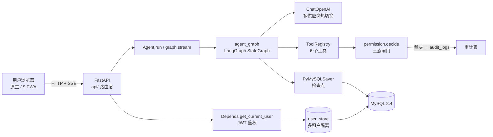

# 多租户 AI Agent 服务平台（agent_platform）

> Multi-tenant AI Agent platform built with LangGraph + FastAPI + MySQL.
> 支持多用户注册登录、会话隔离、工具权限闸门、审计留痕，多家 LLM 供应商热切换，
> 原生 JS Web/PWA 前端（零框架、SSE 流式），Docker Compose 一键部署。

---

## 一、项目简介

一个面向「对外多用户服务」的 AI Agent 平台：多个用户各自注册、登录后拥有独立会话与文件空间，
Agent 在受限工具集内自主调用工具完成多轮任务，所有工具调用经过统一的权限闸门裁决
（允许 / 拒绝 / 询问），对话状态经 LangGraph 检查点持久化到 MySQL。

**已实现的核心能力**

- **多租户用户体系**：注册 / 登录 / 登出，密码 bcrypt 哈希，对外 ID 用 UUIDv4（防枚举、防 IDOR）
- **JWT 无状态鉴权**：`python-jose` 签发 HS256，`Depends(get_current_user)` 统一解析，多端可用
- **会话隔离**：每个会话绑定 `user_id`，任何涉及 session 的操作都先做越权校验（IDOR 防护）
- **工具权限闸门** `permission.decide()`：三态裁决 `ALLOW / DENY / ASK`，白名单 + shell 元字符过滤 + 路径根隔离
- **多家 LLM 供应商热切换**：`providers.py` 维护预设目录，8 家 + 自定义，无需改代码
- **LangGraph 编排层**：`StateGraph` + `PyMySQLSaver` 检查点（对话历史落 MySQL，跨轮记忆）
- **上下文压缩**：早期消息由 LLM 摘要进 `session.summary`，上下文不随对话无限增长
- **真实 token 记账**：从 `AIMessage.usage_metadata` 累加，配额限流真正生效
- **审计落库**：每次裁决写入 `audit_logs`（subject / 决策）
- **REST API + Web/PWA 前端**：FastAPI 提供 API，同进程托管原生 JS 单页应用（SSE 流式）
- **容器化部署**：Dockerfile + Docker Compose 编排 app + MySQL

---

## 二、技术栈

| 层 | 技术 | 说明 |
|---|---|---|
| Web 前端 | **原生 JS（ES Modules）** | 零框架零构建，PWA 可安装；Fetch Streams 消费 SSE 流式输出 |
| REST API | **FastAPI** 0.141 + **uvicorn** | Pydantic 请求/响应校验，`Depends` 依赖注入鉴权 |
| 鉴权 | **python-jose** JWT (HS256) | 无状态，密钥走环境变量 `AGENT_JWT_SECRET` |
| Agent 编排 | **LangGraph** 1.2 | `StateGraph` 状态机 + `PyMySQLSaver` 检查点（MySQL 持久化） |
| LLM 客户端 | **langchain-openai** `ChatOpenAI` | 走 OpenAI 兼容协议，一套客户端打通所有供应商 |
| 数据库 | **MySQL 8.4** LTS | 关系数据 + LangGraph 检查点三表 |
| 数据库驱动 | **PyMySQL** | 纯 Python 实现，跨平台免编译 |
| 密码安全 | **bcrypt** | 自适应慢哈希，哈希串自带 salt |
| 容器化 | **Docker** + **Docker Compose** | 单镜像 + db 服务编排，配置经 `.env` 外置 |
| 测试 | **pytest** | `tests/test_permission.py` 权限闸门单测 |

> 早期 Gradio 界面（`webui.py`）已于 2026-10-21 归档至 `_deprecated/`，
> `gradio` 依赖随之从 `requirements.txt` 移除（全项目确认无其他引用）。
> 详见 `_deprecated/README.md` 与 `docs/ARCHIVED.md`。

---

## 三、系统架构



**模块职责**

- `api/app.py` — FastAPI 入口；lifespan 构建 checkpointer + Agent 单例挂 `app.state`；API 路由之后挂载静态前端
- `api/auth.py` — 注册 / 登录，签发 JWT
- `api/chat.py` — 会话 CRUD、历史回看、会话状态、同步/流式对话（SSE）
- `api/config.py` — 运行配置查询（模型 / 工具 / 权限规则，**脱敏不含 api_key**）
- `api/deps.py` — JWT 签发与 `get_current_user` 依赖
- `api/schemas.py` — Pydantic 请求/响应模型（`response_model` 兼做字段白名单）
- `core/agent.py` — `Agent` 类：工具注册表、LLM 配置加载（环境变量优先，`config.json` 回落）、`configure()` 热切换、`run()` 驱动图执行、`_compress()` 上下文压缩
- `core/agent_graph.py` — `build_agent_graph()`：LangGraph `StateGraph` 编排「模型调用 → 工具调用 → 回环」循环
- `core/tools.py` — `TOOLS` 工具注册表，6 个工具：文件读写、列目录、命令执行、天气、时间
- `core/permission.py` — `decide()` 权限闸门，`_subject()` 审计 subject，路径根隔离 + shell 元字符过滤
- `core/providers.py` — `PRESETS` 供应商预设目录 + `resolve()` 解析
- `core/context.py` — 请求级身份（`contextvars`）：让文件工具落在 `workspace/{user_id}/`，并让审计日志归属到人
- `storage/db.py` — PyMySQL 连接与 `query / execute / transaction`，凭据全部来自 `AGENT_DB_*` 环境变量
- `storage/checkpointer.py` — `build_checkpointer()`：原生 `pymysql` 连接 + `PyMySQLSaver.setup()` 幂等建检查点三表
- `storage/user_store.py` — 注册 / 登录 / 配额校验 / 用量记录 / 会话 CRUD（多租户隔离）
- `storage/audit.py` — 裁决落 `audit_logs`（旁路，失败不影响裁决）
- `static/` — 原生 JS 前端：`index.html` / `css/style.css` / `js/api.js`（fetch 层）/ `js/app.js`（状态 + 渲染）
- `_deprecated/` — 已废弃文件归档（Gradio 界面 / CLI 入口 / 历史备份），**不进镜像**，见其 README
- `docs/ARCHIVED.md` — 已移除代码的归档与优化说明（被什么取代 / 原实现问题 / 优化点）

---

## 四、目录结构

```
agent_demo/
├── run.py                # 一键启动 uvicorn（自动加载 .env，无需 cd）
├── config.json           # 本地密钥（.gitignore 忽略，禁止提交）
├── config.json.example   # 配置示例（可提交）
├── schema.sql            # 6 张业务表 DDL（messages 表为预留未启用）
├── requirements.txt      # 依赖清单（gradio 已移除）
├── Dockerfile            # 应用镜像（python:3.11-slim，非 root 运行）
├── docker-compose.yml    # app + mysql 编排
├── .dockerignore         # 构建上下文排除（config.json/.env/缓存/_deprecated）
├── .env.example          # 环境变量模板（cp .env.example .env）
├── .env.example          # 环境变量模板
├── api/                  # FastAPI 路由层
│   ├── app.py  auth.py  chat.py  config.py  deps.py  schemas.py
├── core/                 # Agent 编排 + 权限 + 工具
│   ├── agent.py  agent_graph.py  agent_state.py  context.py
│   ├── tools.py  permission.py  prompt.py  providers.py
├── storage/              # MySQL 数据层
│   ├── db.py  checkpointer.py  session.py  user_store.py  audit.py
├── static/               # 原生 JS 前端（PWA）
│   ├── index.html  manifest.json
│   ├── css/style.css
│   └── js/api.js  js/app.js
├── _deprecated/          # 已废弃文件归档（不进镜像）
│   ├── README.md         # 每个文件为什么不用了 + 怎么恢复
│   ├── webui.py  main.py  debug_llm.py
│   └── backups/          # 历史 .bak / .orig 快照
├── docs/
│   └── ARCHIVED.md       # 已移除代码的归档与优化说明
└── tests/
    └── test_permission.py
```

---

## 五、数据模型（MySQL 8.4）

`schema.sql` 建立 6 张表，字符集 `utf8mb4`（MySQL 的 `utf8` 是 3 字节残废版，存不了 emoji）：

| 表 | 作用 | 关键设计 |
|---|---|---|
| `users` | 用户 | 自增 `id`（聚簇主键，顺序插入无页分裂）+ `uuid`(对外 ID，防枚举) + `password_hash`(bcrypt) |
| `sessions` | 会话 | `id`=UUID 且作为 LangGraph `thread_id`；`user_id` 多租户隔离键；`summary` 压缩长期记忆 |
| `messages` | 消息 | 拆表而非塞 JSON 列：避免写放大、支持分页、避免并发覆盖；`seq` 会话内递增序号 |
| `audit_logs` | 审计 | `decision` 三态枚举；外键 `ON DELETE SET NULL`（用户注销后审计留存，合规凭证） |
| `quotas` | 配额 | 每用户每日 token / 请求上限、QPS、并发会话上限 |
| `usage_daily` | 用量 | 按 UTC 日期幂等累加（`INSERT ... AS new ON DUPLICATE KEY UPDATE`） |

LangGraph 检查点三表（`checkpoints` / `checkpoint_writes` / `checkpoint_blobs`）由 `PyMySQLSaver.setup()` 自动创建。

---

## 六、REST API

所有 `/api/v1/*` 端点均需 `Authorization: Bearer <JWT>`。

| 方法 | 路径 | 说明 |
|---|---|---|
| POST | `/api/v1/auth/register` | 注册（成功即返回 token） |
| POST | `/api/v1/auth/login` | 登录 |
| GET | `/api/v1/sessions` | 我的会话列表 |
| POST | `/api/v1/sessions` | 新建会话 |
| GET | `/api/v1/sessions/{id}/messages` | 会话历史（从 checkpointer 恢复） |
| GET | `/api/v1/sessions/{id}/status` | 消息条数 + 上下文压缩状态 |
| GET | `/api/v1/config` | 运行配置：provider / model / 工具 / 权限规则（**不含 api_key**） |
| POST | `/api/v1/chat` | 同步对话 |
| POST | `/api/v1/chat/stream` | SSE 流式对话（增量输出） |
| GET | `/health` | 健康检查 |

交互式文档：启动后访问 `/docs`（Swagger UI）。

---

## 七、多模型供应商配置

`core/providers.py` 预设 8 家 + 自定义入口，全部走 OpenAI 兼容协议：

| provider 值 | 名称 | base_url |
|---|---|---|
| `modelscope` | 魔搭 ModelScope（Qwen） | `https://api-inference.modelscope.cn/v1` |
| `deepseek` | DeepSeek | `https://api.deepseek.com/v1` |
| `doubao` | 豆包 火山方舟 | `https://ark.cn-beijing.volces.com/api/v3` |
| `openai` | GPT OpenAI | `https://api.openai.com/v1` |
| `claude` | Claude Anthropic | `https://api.anthropic.com/v1` |
| `qwen` | 千问 阿里百炼 | `https://dashscope.aliyuncs.com/compatible-mode/v1` |
| `kimi` | Kimi Moonshot | `https://api.moonshot.cn/v1` |
| `custom` | 自定义 | 手填 Base URL + 模型名 |

优先级：**环境变量 `MODELSCOPE_API_KEY`（生产注入）> `config.json`（网页保存）**。

---

## 八、快速开始

### 方式 A：Docker Compose（推荐，一条命令起全栈）

前置：Docker Desktop（WSL2 backend）+ 已配置国内镜像源（Docker Hub 在大陆被 DNS 污染）。

```bash
# 1. 准备环境变量
cp .env.example .env
# 编辑 .env：MYSQL_ROOT_PASSWORD / AGENT_DB_PASSWORD / MODELSCOPE_API_KEY

# 2. 构建并启动（首次拉镜像 + 装依赖，5-15 分钟）
docker compose up -d --build

# 3. 验证
docker compose ps          # agent_mysql / agent_app 均 running
```

打开 `http://localhost:8000/`。数据库由 `schema.sql` 挂载到 `docker-entrypoint-initdb.d/` 自动初始化，
检查点三表由 app 启动时 `saver.setup()` 幂等创建。

> 若本机已跑 MySQL 占用 3306，compose 中 db 的宿主端口映射默认注释，app 走服务名 `db` 内网互连。

### 方式 B：本地运行

```bash
# 1. 安装依赖
pip install -r requirements.txt

# 2. 初始化数据库
mysql -uroot -p < schema.sql

# 3. 配置环境变量
export AGENT_DB_PASSWORD="你的强密码"
export MODELSCOPE_API_KEY="ms-xxxx"

# 4. 启动
python run.py              # 等价于 uvicorn api.app:app --host 0.0.0.0 --port 8000
```

可选覆盖：`AGENT_DB_HOST`(127.0.0.1)、`AGENT_DB_PORT`(3306)、`AGENT_DB_USER`(agent_app)、
`AGENT_DB_NAME`(agent_platform)、`AGENT_DB_URI`(一键连接串，优先)、`AGENT_JWT_SECRET`(JWT 密钥)。

### 运行测试

```bash
pytest tests/
```

---

## 九、安全设计

- **密码**：bcrypt 哈希，绝不明文存储，哈希串自带 salt
- **对外 ID**：用户/会话用 UUIDv4，`users.id` 仅作内部聚簇主键，杜绝 IDOR / 顺序枚举
- **多租户隔离**：任何涉及 session 的操作先 `get_session_for_user(session_id, user_id)` 越权校验，非本人会话一律 404
- **权限闸门**：`execute_command` 含 shell 元字符（`| ; & < > \` $()` 等）直接 `DENY`；文件工具限定在 `workspace` 根内（`os.path.commonpath` 防越界）；白名单命令 `ALLOW`，其余 `ASK`
- **审计**：每次裁决旁路落 `audit_logs`，外键 `ON DELETE SET NULL` 保证用户注销后审计留存
- **配置外置**：数据库密码、API Key、JWT 密钥走环境变量；`config.json` 与 `.env` 均在 `.gitignore` 与 `.dockerignore` 中
- **镜像脱敏**：`GET /api/v1/config` 经 Pydantic `response_model` 做字段白名单，`api_key` 结构性无法外泄
- **容器安全**：以非 root 用户（uid 10001）运行；`.dockerignore` 阻止密钥与缓存进入镜像层

---

## 十、待完善 / 生产化清单（诚实标注）

以下为代码审查（2026-10-20）发现、按严重级别排序的真实待办。标注 ✅ 的已完成。

### 🔴 P0 上线阻断

- [ ] **JWT 密钥有可猜测的 fallback**：`api/deps.py:20` 在 `AGENT_JWT_SECRET` 缺失时回落
      `"dev-only-insecure-secret-change-me"`，而 `docker-compose.yml` 未注入该变量。
      攻击者用源码里的公开默认值即可伪造任意用户 token → 账户接管。
      **修法**：启动即校验，缺失则拒绝启动；compose 必填。

### 🟠 P1 多租户场景下真实可达

- [ ] **文件工具无租户隔离**：`core/tools.py` 的 `ROOT` 是全局单一 `workspace/`，所有租户共享。
      用户 A 写入的文件可被用户 B 通过提示词读写。**修法**：按 `user_id` 建 `workspace/{user_id}/` 子目录。
- [ ] **审计日志缺用户上下文**：`permission.decide()` 无 `user_id/session_id` 入参，
      `audit_logs` 对应列恒为 NULL，多租户下无法追溯责任人。**修法**：把用户身份透传进 `decide → audit`。
- [ ] **配额检查与记账非原子**：`check_quota()`（读）与 `record_usage()`（写）无行锁，
      并发请求可同时通过校验、同时跑 LLM，配额被超出 N 倍。**修法**：`SELECT ... FOR UPDATE` 或带条件原子扣减。

### 🟡 P2 生产质量

- [ ] **CORS 过宽**：`api/app.py` `allow_origins=["*"]` + `allow_credentials=True`。
      **修法**：收敛为前端域名白名单。
- [ ] **错误信息泄露内部细节**：内部异常原文（含连接串/堆栈）直接作为 AI 回答返回客户端。
      **修法**：对外返回通用文案，详情仅进服务端日志。
- [ ] **客户端断连不取消 producer**：`/chat/stream` 中 `graph.stream` 在线程池持续跑，
      断连后仍烧 token 且线程不回收；`record_usage` 不执行导致用量漏记。
      **修法**：`request.is_disconnected()` 检测 + 记账放 `finally`。
- [ ] **无连接池**：`storage/db.py` 每次查询新建连接，单次对话约开 5 条，
      并发下易耗尽。**修法**：引入连接池（DBUtils / SQLAlchemy pool）。
- [ ] **注册竞态**：`user_store.register()` 先 SELECT 再 INSERT，跨事务无锁，
      并发同名注册抛 `IntegrityError` → 500（应为 409）。**修法**：捕获唯一键冲突转 409。

### 🟢 P3 打磨项

- [ ] **JWT 无过期时间**：token 无 `exp`，泄露即永久有效。**修法**：加 `exp` 并校验。
- [ ] **`role` 字段未使用**：token 含 role 但无任何 RBAC enforcement（若计划做管理后台需补）。
- [ ] **`shell=True` + 白名单过宽**：`WHITELIST` 中 `dir` 前缀全放行，共享主机上可读全盘。
      **修法**：避免 `shell=True`，收窄白名单。
- [ ] **`reply` 可能为 None**：末条为仅工具调用的 AIMessage 时 `content=None`，
      `ChatResponse(reply: str)` 序列化失败。**修法**：`content or ""`。
- [ ] **`asyncio.get_event_loop()` 已弃用**：改用 `get_running_loop()`。

### ✅ 已完成（曾列入路线图）

- ✅ 审计落库（`storage/audit.py`，`decide()` 旁路写入，失败不影响裁决）
- ✅ 真实 token 记账（从 `usage_metadata` 提取，配额真正生效）
- ✅ FastAPI REST API 层（含 SSE 流式）
- ✅ 原生 JS Web/PWA 前端（零框架、Fetch Streams、localStorage JWT）
- ✅ 历史回看 + 上下文压缩状态展示
- ✅ Docker 容器化部署（Compose 编排 app + MySQL）
- ✅ 跨平台：依赖全纯 Python，Linux 优先部署

### 📋 路线图（未开始）

- [ ] RAG / 向量库（Chroma 起步 → Qdrant）
- [ ] MCP 协议支持
- [ ] 派工式多 Agent（子 Agent 上下文隔离、权限收敛）
- [ ] 前端「任务 + 技能」体系（用户可创建自定义技能）

---

## 十一、License

本项目仅供学习与交流使用。
